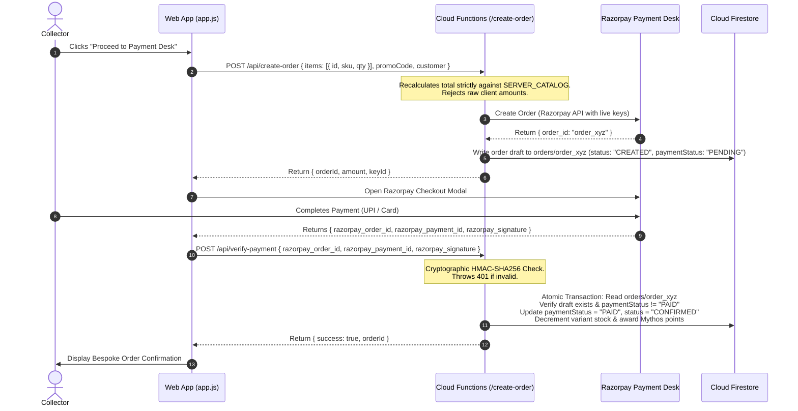

# Mytholis — Haute Parfumerie: Master Project & Architecture Specification

---

## 1. Executive Summary & Brand Identity

**Mytholis** (`mytholis.com`) is an ultra-luxury bespoke e-commerce and digital flagship platform for an artisanal haute parfumerie house. Formulated in **Mayfair, London UK** and hand-crafted and bottled in **Ahmedabad, India**, Mytholis operates at the pinnacle of olfactory craftsmanship with **40% Extrait de Parfum** oil concentration.

### 1.1 Brand Tenets
- **Tagline**: *"Wear Your Legend."*
- **Anthology Line**: *"Six elements. Six legends. One sanctuary."*
- **Visual Identity**: Obsidian glass aesthetics, deep forest emerald backgrounds (`#020C08`), radiant gold filigree typography (`#D4AF37`), neon-halo typographic accents, and physics-informed 3D convex card arc animations.
- **Brand Vocabulary**:
  - Storefront / House $\rightarrow$ **Sanctuary**
  - Customer / User $\rightarrow$ **Collector**
  - Backoffice / Admin Desk $\rightarrow$ **Sanctum Command**
  - Loyalty Currency $\rightarrow$ **Mythos Points**
  - Loyalty Program $\rightarrow$ **Circle of Legends**

---

## 2. Olfactory Portfolio & Product Catalog

The Mytholis collection comprises six master Extrait de Parfum flacons and one signature discovery coffret:

| Flacon / Product | Classification | Olfactory Accord | 50ml MRP | 100ml MRP | SKU Baseline |
| :--- | :--- | :--- | :--- | :--- | :--- |
| **King Scar** | Masculine | Aromatic Spicy, Lavender, Absinthe, Vetiver | ₹3,499 | ₹5,999 | `MYTH-EDP-KS` |
| **Petralux** | Unisex | Opulent Fruity Chypre, Pineapple, Birch, Amber | ₹2,799 | ₹4,999 | `MYTH-EDP-PX` |
| **Oud Rion** | Masculine | Resinous Royal Oud, Assam Agarwood, Saffron | ₹4,099 | ₹6,999 | `MYTH-EDP-OR` |
| **Spark** | Unisex | Electric Aromatic, Fresh Leather, Neroli, Iris | ₹3,199 | ₹5,499 | `MYTH-EDP-SP` |
| **Wood Sera** | Unisex | Warm Woody Amber Rose, Praline, Oud, Vanilla | ₹2,799 | ₹4,999 | `MYTH-EDP-WS` |
| **Ash** | Unisex | Smoky Woody Mineral, Sandalwood, Incense, Cedar | ₹3,499 | ₹5,999 | `MYTH-EDP-AS` |
| **The Sixth Sense** | Master Coffret | 6 × 8ml Deluxe Vials (48ml total) | ₹3,999 (48ml) | — | `MYTH-SET-6S-48` |

All retail prices are Maximum Retail Prices (MRP) inclusive of 18% Goods and Services Tax (GST) and express armored delivery.

---

## 3. Technology Stack & System Architecture

```
                       [ Collectors & Visitors ]
                                   │
                                   ▼
                   [ Cloudflare CDN / Custom Domain ]
                                   │
                                   ▼
                   [ Firebase Hosting (CDN Edge) ]
                       ┌───────────┴───────────┐
                       ▼                       ▼
            [ Single Page Application ]   [ /api/** Rewrites ]
            • Vite 6 + Vanilla ES Modules        │
            • GSAP 3.15 3D Animation             ▼
            • Reactive Store Pattern      [ Cloud Functions Gen 2 ]
            • Capacitor 8 (Android)       • Node.js 22 + Express 4
                       │                  • Server-Authoritative Catalog
                       ▼                  • Razorpay REST API
            [ Firebase Web SDK ]          • Firebase Admin SDK
                       │                       │
                       └───────────┬───────────┘
                                   ▼
                   [ Google Cloud Firestore Database ]
                   • /orders (Transactional Order Drafts)
                   • /users (Collector Profiles & Mythos)
                   • /products (Catalog & Variant Inventory)
                   • /settings (Admin Configuration)
```

### 3.1 Core Technologies
- **Runtime & Bundler**: Vite 6.2.0 (ES Modules)
- **Frontend Architecture**: Vanilla JavaScript (ES6+ Class Controllers) without heavy frontend framework overhead, achieving sub-second first-contentful paint.
- **Motion & Physics Engine**: GreenSock Animation Platform (`gsap` 3.15.0) powering convex fan arcs, mouse-tilt perspective, smooth scroll, and kinetic typography.
- **Serverless Backend**: Google Cloud Functions (2nd Gen), Node.js 22 runtime, Express 4.21 API server.
- **Database & Auth**: Google Cloud Firestore (Standard mode) & Firebase Authentication (Email/Password, Phone OTP, Google OAuth).
- **Payment Gateway**: Razorpay Payment Suite (UPI Instant Discount, Cards, NetBanking, COD verification).
- **Mobile Packaging**: Capacitor 8 (`@capacitor/android`) generating native Android APK/AAB bundles.
- **Document Processing**: `pdf-lib` for client-side generation of bespoke dispatch invoices and luxury packing slips.

---

## 4. Frontend Architecture & Modular Organization

The client-side codebase is cleanly split into specialized modules under `js/` and styles under `css/`:

```
Mytholis/
├── assets/                     # Master raw product photography, box renders, webp assets
├── public/                     # Static assets directly served by Vite & Firebase
│   └── assets/product/         # Publicly mounted media assets
├── css/
│   ├── style.css               # Core CSS variables, typography, baseline reset
│   └── components.css          # Component styling: hero 3D fan, liquid cards, modals, gallery
├── js/
│   ├── catalog.js              # Client-authoritative catalog definitions, notes, media galleries
│   ├── store.js                # State machine: Cart, active discounts, loyalty points, session
│   ├── components.js           # Visual components: Hero, Product Showcase, Cart Drawer, Quiz
│   ├── adminComponents.js      # Sanctum Command administration views, telemetry, order editors
│   ├── firebase.js             # Firebase SDK client wrapper, authentication & Firestore listener
│   ├── labelRebrander.js       # Bespoke PDF invoice and shipping label generator
│   └── app.js                  # Master application controller, hash routing, modal managers
├── functions/                  # Cloud Functions server-side backend
│   ├── catalog.js              # Server-authoritative catalog, SKU maps, and pricing engine
│   ├── index.js                # Express app entrypoint & 2nd Gen HTTPS function exporter
│   ├── handlers/               # Modular API endpoint controllers
│   │   ├── razorpay/           # Order creation & HMAC signature verification
│   │   ├── patron/             # Collector profile reconciliation & deduplication
│   │   ├── admin.js            # Privilege escalation & diagnostics
│   │   ├── dispatch.js         # Courier & fulfillment integration
│   │   └── complete-order.js   # COD ledger recording
├── firestore.rules             # Declarative security rules protecting database collections
├── firebase.json               # Firebase hosting, headers, rewrites, and function config
└── capacitor.config.json       # Android mobile container configuration
```

### 4.1 Master State Machine (`js/store.js`)
`MytholisStore` implements a lightweight publish-subscribe reactive store:
- **Cart Management**: Cart line items are keyed uniquely by variant SKU (`${id}-${size}`), allowing collectors to hold both 50ml and 100ml bottles of the same extrait simultaneously.
- **Prepaid UPI Privilege**: Automatically calculates an instant ₹200 reduction on orders $\ge$ ₹2,000 paid via UPI (non-stackable with promotional coupons).
- **Promo Code Engine**: Supports percentage discounts (e.g. `FIRST20` for 20% off), flat vouchers (`VIP500`, `ROYAL500`), and the discovery coffret voucher (`MYTH-COFFRET-1000`).
- **Mythos Loyalty Calculation**: Evaluates qualifying points, tier thresholds, and 30% order concession caps.

### 4.2 Interactive 3D Hero Fan (`js/components.js`, `css/components.css`)
- Displays the six extraits in a mathematical convex arc with computed rotations ($-10^\circ, -6^\circ, -2^\circ, +2^\circ, +6^\circ, +10^\circ$) and depth offsets.
- Wordmark `"ONE SANCTUARY"` renders with hollow neon halo typography (`-webkit-text-stroke: 1.4px rgba(212, 175, 55, 0.35)`) placed at `z-index: 2`, seamlessly underlapping behind the flacon cards row (`z-index: 6`).
- Compact height scaling ensures the hero adapts smoothly to small laptop screens (768px–1440px width with $<740\text{px}$ viewport height).

### 4.3 Multi-Photo Product Gallery
- Supports up to 10 photos per product: crystal bottle shots, outer luxury packaging boxes, artisanal notes breakdown, and atmospheric background renders.
- Interactive thumbnail carousel with smooth opacity cross-fading, active indicator glows, and bidirectional navigation arrows.

---

## 5. Server-Authoritative Backend & Financial Security

Project Mytholis enforces zero-trust security protocols across all transactions in accordance with `AGENTS.md`.



### 5.1 Financial Integrity Rules
1. **Zero Client Price Trust**: The server completely ignores any `amount`, `subtotal`, or `price` parameters in requests. The order total is calculated exclusively by `calculateServerOrderTotal()` using `functions/catalog.js`.
2. **Authoritative Order Draft Ledger**: Before the checkout modal opens, an immutable draft is persisted in Firestore `orders/{orderId}` containing verified quantities, unit prices, applied coupons, and calculated totals.
3. **Fail-Closed Cryptographic Verification**:
   - Razorpay HMAC signature (`razorpay_order_id + "|" + razorpay_payment_id`) is signed using `process.env.RAZORPAY_KEY_SECRET`.
   - If missing, invalid, or mismatched, immediately rejects with `401 Unauthorized`.
4. **Transaction Idempotency**:
   - Firestore `runTransaction` prevents double-awarding of Mythos points or duplicate stock decrements on retried webhook or verification callbacks.
5. **Variant-Level Stock Decrements**:
   - Updates `variants.50ml.stock` or `variants.100ml.stock` atomically upon payment verification.

---

## 6. Firestore Security Rules & Access Control

`firestore.rules` guarantees least-privilege security across all collections:

- **Authentication & Custom Claims**: Administrative access is gated on `request.auth.token.admin == true` (minted strictly via Admin SDK) with a secure verified-email emergency bridge.
- **Collector Self-Writes**: Collectors may only create or update personal delivery address and profile fields (`selfWritableFields()`). Writes to administrative attributes (`role`, `isAdmin`, `loyalty`, `tier`, `referralCode`) are rejected at the database engine level.
- **Order Collection Protection**: Client creation of orders is blocked (`allow create: if false`). Orders can only be instantiated by Cloud Functions via the Firebase Admin SDK. Collectors may read only orders matching their own authenticated `uid` or verified email.
- **Settings & Vouchers**: Global configurations (`/settings/*`) and the voucher vault (`/reward_codes/*`, `/vouchers/*`) are completely hidden from public enumeration.

---

## 7. Administrative Command Desk ("Sanctum Command")

Accessible at `/#admin` for verified administrators, the Sanctum Command console provides executive operations:

1. **Executive Telemetry**:
   - Real-time Gross Merchandise Value (GMV), net revenue, and average order value.
   - Live order conversion ratios and payment channel breakdowns (Prepaid UPI vs. Cards vs. COD).
2. **Orders Ledger & Fulfillment**:
   - Filter orders by fulfillment status (`CREATED`, `CONFIRMED`, `DISPATCHED`, `DELIVERED`).
   - One-click bespoke PDF invoice generation and shipping label formatting via `pdf-lib`.
   - Instant WhatsApp dispatch confirmation generator with obsidian seal notices.
3. **Product & Inventory Matrix**:
   - Manage multi-variant stock levels for 50ml and 100ml flacons.
   - Multi-photo gallery editor supporting up to 10 image URLs per extrait with auto-mapping presets.
4. **Voucher & Concession Mint**:
   - Mint bespoke promotional codes and reward vouchers directly into the secure ledger.
5. **Session Safety**:
   - `"Exit Sanctum"` seamlessly returns the founder to the public storefront without destroying authentication credentials.
   - Distinct `"Sign Out"` action explicitly terminates the secure session when needed.

---

## 8. Mobile & Android Containerization

Mytholis is configured for cross-platform distribution using Capacitor 8:
- **App Identifier**: `com.samar.mytholis`
- **Application Name**: `Mytholis`
- **Security Hygiene**:
  - `"allowMixedContent": false` strictly enforced in `capacitor.config.json` to prevent unencrypted HTTP traffic.
  - Native background color `#020C08` configured to avoid white screen flashes during cold boots.
  - Safe area insets (`env(safe-area-inset-*)`) dynamically handle camera cutouts and navigation bars.

---

## 9. Deployment & Operations Runbook

### 9.1 Local Development
```bash
# Install frontend and function dependencies
npm install
cd functions && npm install && cd ..

# Launch Vite development server
npm run dev

# Run local API emulator with environment variables
cd functions && npm run serve:local
```

### 9.2 Production Build & Verification
```bash
# Compile and optimize production bundle
npm run build

# Run local preview
npm run preview
```

### 9.3 Production Cloud Deployment
```bash
# Deploy full stack (Hosting + Cloud Functions + Firestore Rules)
npm run deploy

# Deploy frontend hosting updates only
npm run deploy:hosting

# Deploy Cloud Functions backend only
npm run deploy:functions
```

### 9.4 Android Synchronization
```bash
# Build web dist and sync with Android native project
npm run android:sync

# Open Android Studio project
npm run android:open
```

---

## 10. Repository File Index & Responsibility Matrix

| Path | Primary Function | Authority Level |
| :--- | :--- | :--- |
| `js/app.js` | Routing, event binding, gallery switcher, modal controller | Client |
| `js/store.js` | Cart state, promotional rules, Mythos loyalty calculator | Client State |
| `js/components.js` | Storefront UI templates, hero 3D fan, checkout modals | Client Render |
| `js/adminComponents.js` | Sanctum Command dashboard views, telemetry, matrix editors | Client Render (Admin) |
| `js/catalog.js` | Client catalog descriptions, accords, gallery media lists | Client Data |
| `functions/catalog.js` | Authoritative pricing engine, SKU validator, promo verification | **Server Authoritative** |
| `functions/index.js` | Express API routing, CORS, startup Firestore sanitization | **Server Authoritative** |
| `functions/handlers/` | Payment gateway integration, dispatch, account reconciliation | **Server Authoritative** |
| `firestore.rules` | Database access control, user privilege enforcement | **Database Engine** |
| `capacitor.config.json`| Android container configuration & security policies | Mobile Native |
| `AGENTS.md` | Mandatory security invariants and engineering protocol rules | Project Governance |
